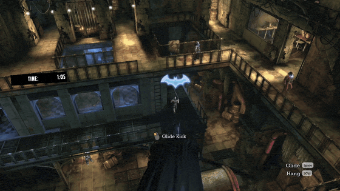
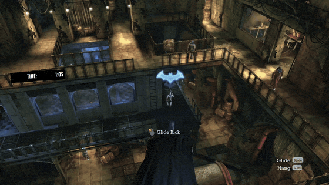

# Batman: Arkham Asylum Flashbang Fix

Toggling detective mode flashbangs you. This removes the flash (which makes the
game playable imo).

| Before | After |
| --- | --- |
|  |  |

## Fix it

**[Open the fixer](https://wasdhjklxyz.github.io/batman-arkham-asylum-detective-mode-flashbang-fix/)**

1. In Steam, right-click **Batman: Arkham Asylum GOTY Edition** → **Manage** →
   **Browse local files**, then go to **BmGame** → **CookedPC**.
2. Drag **BmGame.u** onto the page.
3. Download the fixed file. In **CookedPC**, rename the original to
   **BmGame.u.bak** (your backup), then put the download there as **BmGame.u**.

Nothing gets uploaded. The patch runs inside your browser and you get the file
back as a download. Nothing to install, no sus exe.

## Undo

Delete the fixed **BmGame.u** and rename **BmGame.u.bak** back to
**BmGame.u**. Or let Steam do it: **Properties** → **Installed Files** →
**Verify integrity of game files**. Verifying later undoes the fix too, so
just run it again if that happens.

## FAQ

**Which versions work?** The Steam GOTY Edition. Anything else is untested.
The fixer refuses files it doesn't recognize instead of guessing, so the worst
case is an error message, not a broken game.

**Why is the new file bigger?** The original is compressed (~60 MB). The fixed
one is stored uncompressed (~100 MB). The game loads both just fine.

**Steam Deck / Linux?** Same steps. Or build the CLI (below) and run
`./baadmff path/to/BmGame.u`, which keeps a `BmGame.u.bak` for you.

**Anything else change?** Scan mode (riddles, beetle things) used
the same flash, so that's gone too. Nothing else noticed so far. If you spot
something, open an issue.

## How it works

Detective mode fades the flash in and out through
`RViewPostProcess.SetValForScalarTwo(float Val)`, which just does
`ScalarTwoVal = Val`. The fix rewrites that one UnrealScript assignment to
`ScalarTwoVal = 0.0`. It's 5 bytes of bytecode: `EX_LocalVariable Val` becomes
`EX_FloatConst 0.0`.

To get there, the fixer:

1. Parses the UE3 package summary (version 576, licensee 21)
2. Decompresses the LZO chunks, giving the same result as [Gildor's
   `decompress.exe`](https://www.gildor.org/downloads)
3. Finds the 18-byte function body (exactly one match, or it refuses), patches
   it, and writes the package back uncompressed

## Build

```sh
nix develop
make release    # ./baadmff, CLI
make debug      # ASan + UBSan, verbose logs
make web        # build/web, the site
```

The site is built by CI from the tagged source (`nix build .#web`), and the
deploy log prints each file's sha256. Build it yourself and compare.

## License

GPL-2.0. Uses [miniLZO](http://www.oberhumer.com/opensource/lzo/)
(GPL-2.0+, Markus F.X.J. Oberhumer). Not affiliated with Rocksteady or Warner
Bros.
